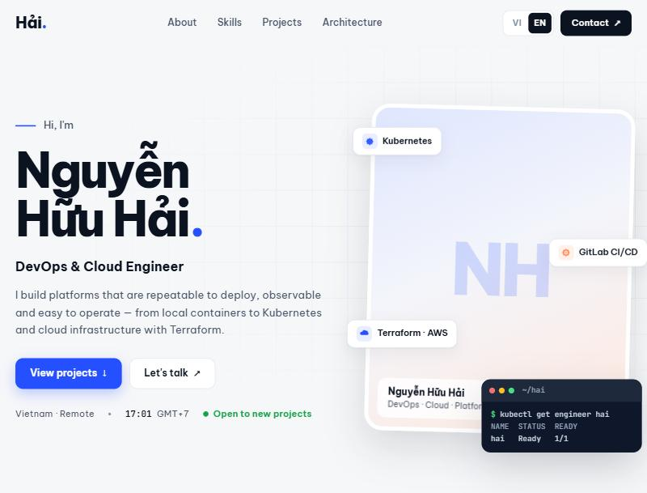

# Personal Web Platform

[](https://github.com/huuhai28/web-platform/actions/workflows/ci.yml)

**Live:** https://nguyenhuuhai.com · English: [?lang=en](https://nguyenhuuhai.com/?lang=en) · API docs: [/api-docs](https://nguyenhuuhai.com/api-docs/) (mirror: web-platform-a68.pages.dev)

> **EN —** An end-to-end DevOps project built around my bilingual portfolio site: **Terraform** provisions a VPC
> and EC2 on AWS, **Ansible** configures the nodes and bootstraps a **kubeadm** cluster, **GitHub Actions** tests,
> builds and pushes images, then deploys with **Helm** behind **Kong Ingress**, monitored by **Prometheus/Grafana**.
> The app itself is FastAPI + Celery + Keycloak (OIDC/PKCE) + PostgreSQL + Redis with a static Nginx frontend.

Website giới thiệu bản thân, đồng thời là project DevOps end-to-end:

```text
Terraform (VPC, EC2) → Ansible (containerd, kubeadm init/join) → GitHub Actions (test → build → GHCR → helm upgrade)
  → Kubernetes: Kong Ingress + KongPlugin, HPA, probes → Prometheus/Grafana (ServiceMonitor, alert, dashboard)
```

| Bước | Thư mục |
|---|---|
| Hạ tầng AWS | [terraform/](terraform/) |
| Cấu hình node + dựng cluster kubeadm | [ansible/](ansible/) |
| Deploy bằng Helm (Kong Ingress, HPA, monitoring) | [helm/](helm/), [.github/workflows/deploy-k8s.yml](.github/workflows/deploy-k8s.yml) |
| CI: test, build, scan | [.github/workflows/ci.yml](.github/workflows/ci.yml) |
| Bản VPS đơn giản (Docker Compose + HTTPS) | [docker-compose.prod.yml](docker-compose.prod.yml) |

### Chạy end-to-end trên AWS

Chỉ cần Docker và `aws configure` (Terraform, Ansible chạy trong container). Chi phí ~0,2 USD/giờ
(control plane `c7i-flex.large` + worker `m7i-flex.large`, loại máy free-tier-eligible; không EKS/NAT Gateway).

```bash
cp terraform/terraform.tfvars.example terraform/terraform.tfvars   # một lần: điền my_ip_cidr, SSH public key, region
bash scripts/aws-up.sh     # BẬT: Terraform → Ansible (kubeadm) → Helm (Kong, Prometheus/Grafana, app) ~25 phút
bash scripts/aws-down.sh   # TẮT: terraform destroy, xóa sạch để không tốn tiền ~3 phút
```

Từng bước riêng lẻ:

```bash
bash terraform/tf.sh init && bash terraform/tf.sh apply             # VPC, Security Group, 2 EC2, inventory Ansible
SSH_KEY=~/.ssh/<private-key> bash ansible/run.sh                    # kubeadm cluster → ansible/artifacts/kubeconfig
```

Deploy: đặt secret `KUBECONFIG_B64` (base64 của kubeconfig), `GRAFANA_ADMIN_PASSWORD` và biến `K8S_NODE_IP`, rồi chạy
workflow **Deploy to Kubernetes** — hoặc từ máy:
`KUBECONFIG=ansible/artifacts/kubeconfig NODE_IP=<ip> INSTALL_MONITORING=1 bash scripts/k8s-lab-deploy.sh`.
Web: `http://personal-web.<ip>.nip.io:30080` · Grafana: `http://<ip>:30300`. Xong thì **`bash terraform/tf.sh destroy`**.

### Kết quả chạy thật (AWS ap-southeast-2, 06/11/2026)

`terraform apply` (16 tài nguyên) → `ansible/run.sh` (cluster kubeadm 2 node) → `scripts/k8s-lab-deploy.sh`
(Kong Ingress + kube-prometheus-stack + chart) — tổng khoảng 25 phút, sau đó `terraform destroy`.



```text
$ kubectl get nodes
NAME             STATUS   ROLES           VERSION    INTERNAL-IP
ip-10-10-1-223   Ready    control-plane   v1.33.13   10.10.1.223
ip-10-10-1-226   Ready    <none>          v1.33.13   10.10.1.226

$ kubectl -n personal-web get ingress,hpa,kongplugins
ingress/personal-web           kong   personal-web.15.134.128.157.nip.io   80
ingress/personal-web-api       kong   personal-web.15.134.128.157.nip.io   80
ingress/personal-web-contact   kong   personal-web.15.134.128.157.nip.io   80
hpa/backend   Deployment/backend   cpu: 3%/70%   2   5   2
kongplugin/pw-api-rate-limit       rate-limiting
kongplugin/pw-contact-rate-limit   rate-limiting
kongplugin/pw-prometheus           prometheus
kongplugin/pw-request-id           correlation-id
kongplugin/pw-request-size         request-size-limiting

$ helm list -A
kong           kong           deployed   ingress-0.24.0
monitoring     monitoring     deployed   kube-prometheus-stack-92.21.2
personal-web   personal-web   deployed   personal-web-0.3.0

$ curl -s -D - -o /dev/null -H "X-Request-ID: from-vietnam-01" http://personal-web.<ip>.nip.io:30080/api/profile
RateLimit-Remaining: 117
x-request-id: from-vietnam-01
Via: 1.1 kong/3.9.4

Form liên hệ gửi 7 lần liên tiếp → 201 201 201 201 201 429 429   (KongPlugin rate limit)
Prometheus: target backend 2/2 up · PrometheusRule: BackendDown, HighErrorRate, HighLatencyP95
```

Sự cố gặp khi chạy thật và cách xử lý: tài khoản bị SCP chặn EC2 ở hầu hết region → dò region được phép
(ap-southeast-2); Free Plan từ chối `t3.medium` → đổi sang loại free-tier-eligible; Ansible chép kubeconfig trước khi
tạo thư mục → sửa thứ tự, chạy lại playbook (kubeadm init được bỏ qua nhờ idempotent).

---

## Project này thể hiện gì

| Mảng | Đã làm |
|---|---|
| **Infrastructure as Code** | **Terraform** (AWS VPC, subnet, IGW, Security Group tối thiểu, EC2 Ubuntu 24.04, IMDSv2, ổ mã hóa, Budget alert; tự sinh inventory cho Ansible) · **Ansible** dựng cluster **kubeadm** idempotent (containerd systemd cgroup, Flannel, metrics-server, local-path, Helm), qua `ansible-lint` profile production. Cả hai chạy trong Docker, CI kiểm tra `terraform validate` + `ansible-lint` |
| **Monitoring** | kube-prometheus-stack; chart tự tạo **ServiceMonitor** cho `/metrics`, **PrometheusRule** (backend down, lỗi 5xx, p95), dashboard Grafana nạp qua ConfigMap |
| **Container** | 7 service bằng Docker Compose; image nhỏ (frontend 74 MB); backend chạy user thường; healthcheck, giới hạn RAM, xoay vòng log |
| **CI/CD** | Cùng một pipeline viết cho **GitHub Actions** và **GitLab CI**: validate (compose, Helm, kubeconform) → test (pytest, kiểm tra JS/bản dịch) → build 3 image song song → Trivy scan → deploy qua SSH (bấm tay hoặc tự động), có rollback theo commit SHA |
| **Kubernetes / Helm** | Helm chart: Deployment, StatefulSet + PVC, **Ingress qua Kong Ingress Controller**, **KongPlugin** (rate limit, request ID, giới hạn body, metrics), **HPA**, readiness/liveness probe, `values-lab.yaml` cho cluster lab; script deploy 1 lệnh tự kiểm tra kết quả; `helm upgrade --atomic` tự rollback khi lỗi |
| **API Gateway (Kong)** | Bản Compose: nginx → **Kong** → FastAPI, Kong Manager, cấu hình khai báo trong Git đồng bộ bằng **decK** (GitOps); đã kiểm chứng rate limit 429, request ID xuyên suốt, metrics theo route |
| **Networking / TLS** | Caddy tự cấp HTTPS Let's Encrypt, HSTS, HTTP/3; Nginx reverse proxy `/api`, `/auth`, lấy IP thật sau proxy |
| **Identity** | Keycloak OIDC Authorization Code + **PKCE tự viết bằng JS thuần**, phân quyền theo realm role, chống brute-force |
| **Security** | CSP chặt (không inline script/style), chặn trang admin Keycloak ra Internet (vào qua SSH tunnel), user DB riêng từng service, rate limit form, không có mật khẩu mặc định ở production, UFW + fail2ban |
| **Async** | Form liên hệ → PostgreSQL → Redis → Celery worker → SMTP |
| **Observability** | Log JSON một dòng có `request_id` xuyên suốt nginx → FastAPI → Celery; `/api/health/live` + `/api/health/ready` (kiểm tra DB, Redis); `/metrics` cho Prometheus. Bộ ELK + Grafana + n8n/AI đọc các tín hiệu này nằm ở repo [ai-log-analyzer](https://github.com/huuhai28/ai-log-analyzer) |
| **API docs** | Swagger UI công khai tại `/api-docs`, sinh từ chính code FastAPI; CI báo lỗi nếu tài liệu lệch code |
| **Serverless** | Form liên hệ trên Cloudflare Pages chạy bằng Pages Function → Resend (email), có test riêng |
| **Vận hành** | Script cài VPS 1 lệnh, backup DB tự động giữ 14 bản, tài liệu deploy + xử lý sự cố |
| **Frontend** | HTML/CSS/JS thuần, không build step; song ngữ Việt/Anh; responsive; hiệu ứng cuộn |

## Kiến trúc

```text
                         ┌──────────────── VPS (Docker Compose) ────────────────┐
Internet ──80/443──► Caddy ──► frontend (nginx) ──┬─ /        HTML/CSS/JS tĩnh (VI/EN)
        HTTPS tự động        rate limit, CSP      ├─ /api/*  ─► backend (FastAPI) ─► PostgreSQL
        chặn /auth/admin                          │               └─► Redis ─► worker (Celery) ─► SMTP
                                                  └─ /auth/* ─► Keycloak (OIDC) ─► PostgreSQL
                         └──────────────────────────────────────────────────────┘
                              Keycloak admin: 127.0.0.1:8080 (chỉ qua SSH tunnel)

GitHub ──push──► Actions: validate → test → build ─► GHCR ──pull (tag = commit SHA)──► VPS
                                            └─► scan (Trivy)
(GitLab CI tương đương: GitLab Registry, thêm job helm upgrade ──► Kubernetes)
```

| Service | Công nghệ | Vai trò |
|---|---|---|
| `caddy` *(prod)* | Caddy 2 | Cổng duy nhất ra Internet, HTTPS tự động |
| `frontend` | Nginx, HTML/CSS/JS | Trang web song ngữ + reverse proxy |
| `backend` | Python 3.13, FastAPI, SQLAlchemy | API, kiểm tra JWT của Keycloak |
| `worker` | Celery | Gửi email thông báo ngoài request chính |
| `keycloak` | Keycloak 26 | Đăng nhập OIDC, phân quyền |
| `postgres` | PostgreSQL 17 | 2 database tách biệt: `portfolio`, `keycloak` |
| `redis` | Redis 7 | Message broker |
| `mailpit` *(dev)* | Mailpit | Hộp thư thử nghiệm |

## Chạy thử trên máy

Yêu cầu: Docker Desktop; cổng `3000`, `8000`, `8025` còn trống.

```bash
docker compose up --build -d
```

| URL | |
|---|---|
| http://localhost:3000 | Trang web (thêm `?lang=en` cho tiếng Anh) |
| http://localhost:3000/#admin | Đăng nhập quản trị — user `hai` / `ChangeMe123!` (chỉ dùng local) |
| http://localhost:8025 | Mailpit — xem email từ form liên hệ |
| http://localhost:3000/api-docs/ | Swagger UI (bản tĩnh, giống trang công khai) |
| http://localhost:8000/docs | Swagger do FastAPI tự sinh (tắt ở production) |
| http://localhost:8000/metrics | Metrics Prometheus (chỉ trong mạng nội bộ, nginx không proxy) |

Chỉ sửa giao diện, không cần Docker: `node scripts/dev_static_server.mjs` → http://localhost:5500.

## Test

```bash
# Backend: 7 test API (SQLite, không cần container)
cd backend && pip install -r requirements-dev.txt && pytest -v

# Frontend: cú pháp JS + đủ bản dịch vi/en
node scripts/check_frontend.mjs

# End-to-end trên stack đang chạy: 14 bước (HTML, Keycloak, đăng nhập, phân quyền, form, admin)
python scripts/full_function_test.py --client-id portfolio-frontend --user demo --admin-user hai
```

Đã kiểm chứng: 14/14 bước E2E trên bản dev; 12/12 bước E2E trên bản production chạy local với HTTPS
(PKCE, refresh token, thu hồi phiên khi dùng lại authorization code, rate limit 429, trang admin bị chặn);
deploy giả lập pull image theo tag từ registry. Load test 1000 user: `scripts/load_test.py`.

## Production

VPS Ubuntu: `scripts/vps_bootstrap.sh` (user deploy, khóa SSH, UFW, fail2ban, swap, Docker), rồi:

```bash
sh scripts/gen_prod_env.sh > .env.prod && chmod 600 .env.prod   # sinh mật khẩu ngẫu nhiên, sửa DOMAIN/SMTP
docker compose -f docker-compose.prod.yml --env-file .env.prod up -d --build
```

RAM thực tế ~1.2 GB cho cả stack (Keycloak build sẵn cấu hình: ~450 MB, khởi động ~25 giây) → VPS 2 vCPU / 4 GB.

## CI/CD

Pipeline chính chạy trên **GitHub Actions** ([.github/workflows/ci.yml](.github/workflows/ci.yml)).
Bản tương đương cho **GitLab CI** ([.gitlab-ci.yml](.gitlab-ci.yml)) dùng GitLab Registry và có thêm job `deploy:k8s` (Helm).

| Giai đoạn | Việc làm | Chạy khi |
|---|---|---|
| validate | `docker compose config` (dev + prod), `helm lint` + `template`, kubeconform | Mọi push và PR |
| test | pytest backend, kiểm tra JS + bản dịch frontend | Mọi push và PR |
| build | 3 image song song (frontend, backend, keycloak) → GHCR, tag = commit SHA + `latest`, cache build | Push `main` |
| scan | Trivy — lỗ hổng HIGH/CRITICAL (báo cáo, không chặn) | Sau build |
| deploy | SSH → chép cấu hình → pull image theo SHA → `compose up --no-build` → health check HTTPS | Bấm *Run workflow*, hoặc tự động nếu `AUTO_DEPLOY=true` |
| rollback | Như deploy nhưng dùng tag cũ | *Run workflow* với `rollback_tag` |

Cấu hình (Settings → Secrets and variables → Actions) — **Secrets:** `SSH_PRIVATE_KEY`, `SSH_KNOWN_HOSTS`,
`DEPLOY_HOST`, `DEPLOY_USER`, `DEPLOY_PATH`; **Variables:** `PUBLIC_URL`, `AUTO_DEPLOY`.
File `.env.prod` (bí mật) chỉ nằm trên VPS, pipeline không bao giờ đọc hay chép nó.

## Kong API Gateway (Docker Compose)

```bash
docker compose -f docker-compose.yml -f docker-compose.gateway.yml up -d
```

Kong Manager: http://localhost:8002 · cấu hình gateway: [infra/kong/kong.yaml](infra/kong/kong.yaml) (decK sync mỗi lần khởi động).

## Kubernetes + Helm + Kong Ingress

```bash
NODE_IP=192.168.0.111 bash scripts/k8s-lab-deploy.sh   # cài Kong Ingress Controller + chart, tự kiểm tra
```

Chart: [helm/personal-web/README.md](helm/personal-web/README.md) · manifest thuần (Kustomize): `kubectl apply -k k8s/base`.

## Ghi chú kỹ thuật — những vấn đề đã gặp

- **Keycloak tạo URL mất cổng** (`localhost:3000` → `localhost`): Nginx gửi `X-Forwarded-Port: $server_port`
  là cổng *bên trong* container (80). Bỏ header này vì cổng đã có trong `Host`.
- **Keycloak ngốn 1.6 GB RAM lúc khởi động** ở `start-dev` do Quarkus build lại cấu hình mỗi lần chạy.
  Image riêng chạy `kc.sh build` một lần → `start --optimized`: ~450 MB, khởi động nhanh gấp đôi.
- **CSP chặn `style=""` sinh bằng JS**: thanh kỹ năng gán `--level` qua CSSOM (`style.setProperty`) thay vì chuỗi HTML.
- **Đứng sau Caddy, Nginx thấy mọi request là `http`**: dùng `map` giữ `X-Forwarded-Proto` từ Caddy, nếu không
  Keycloak tạo redirect `http://` trên site HTTPS.
- **Docker bỏ qua UFW** với cổng publish ra `0.0.0.0`: production chỉ publish 80/443, Keycloak admin bind `127.0.0.1`.
- **Dùng lại authorization code** → Keycloak thu hồi cả refresh token của phiên đó (đúng chuẩn OAuth 2.0).

## Cấu trúc thư mục

```text
personal-web-platform/
├── frontend/
│   ├── site/                  # HTML/CSS/JS thuần
│   │   ├── js/i18n.js         #   câu chữ giao diện vi/en
│   │   ├── js/data.js         #   nội dung: profile, kỹ năng, dự án (vi/en)
│   │   ├── js/auth.js         #   OIDC + PKCE không thư viện
│   │   └── js/app.js          #   render, form, khu vực admin
│   ├── nginx/default.conf.template  # reverse proxy, header bảo mật, rate limit, log JSON
│   └── Dockerfile
├── backend/                   # FastAPI + Celery, tests/ (pytest)
├── infra/
│   ├── caddy/Caddyfile        # HTTPS, chặn đường dẫn admin
│   ├── keycloak/              # Dockerfile (optimized) + realm dev/prod
│   ├── kong/kong.yaml         # cấu hình Kong khai báo (decK)
│   └── postgres/              # script tạo DB/user
├── terraform/                 # AWS: VPC, EC2, Security Group, Budget (tf.sh chạy trong Docker)
├── ansible/                   # containerd + kubeadm init/join + add-on (run.sh chạy trong Docker)
├── helm/personal-web/         # Helm chart (+ values-lab.yaml: Kong Ingress, HPA, ServiceMonitor)
├── helm/monitoring/           # values cho kube-prometheus-stack
├── k8s/base/                  # Kustomize manifests
├── scripts/                   # cài VPS, deploy K8s lab, sinh env, backup, xuất OpenAPI, test E2E/load test
├── docker-compose.yml         # dev
├── docker-compose.gateway.yml # thêm Kong API Gateway vào bản dev
├── docker-compose.prod.yml    # production
├── .github/workflows/ci.yml   # GitHub Actions: validate, IaC, test, build, scan
├── .github/workflows/deploy-k8s.yml # GitHub Actions: Helm deploy lên cluster
└── .gitlab-ci.yml             # GitLab CI (tương đương)
```

## Hướng phát triển

- Trang status công khai (Uptime Kuma); giám sát + phân tích log bằng AI đã tách sang repo ai-log-analyzer.
- Đưa backup ra ngoài VPS (S3 / Google Drive) và diễn tập khôi phục định kỳ.
- Blog kỹ thuật viết bằng Markdown; trang CV tải xuống.
- Kubernetes: Ingress + cert-manager, NetworkPolicy, HPA, GitOps với Argo CD.
